<div align="center">

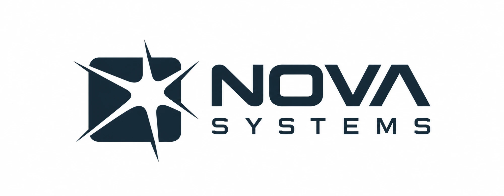

### Emergency-department patient flow, in the patient's own language

AI agents take the paperwork. Nurses and doctors make every decision.

Built for an AI in Healthcare hackathon · synthetic data only · not a medical device

</div>

<p align="center">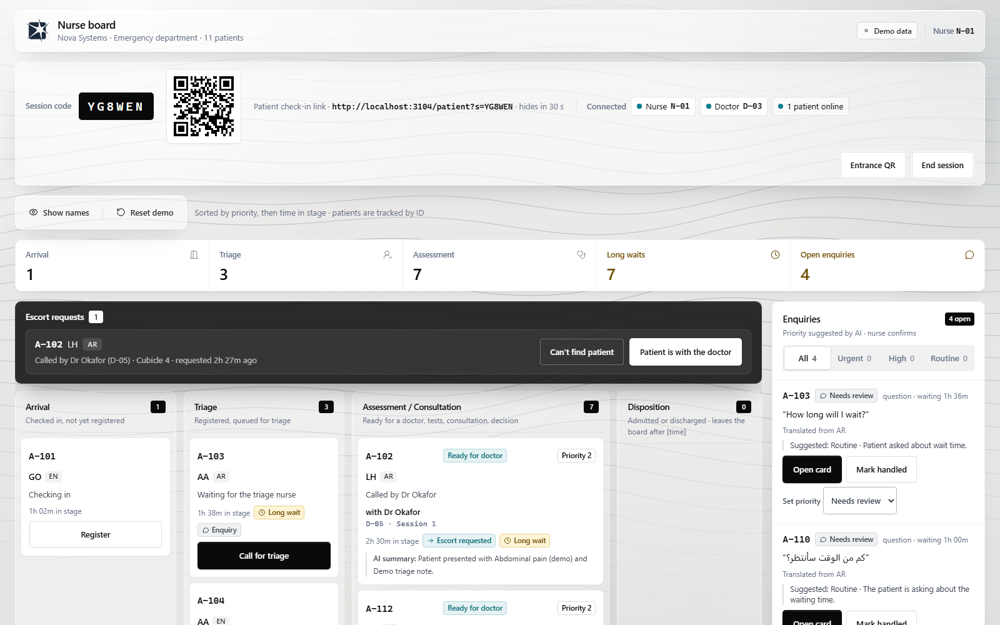</p>

## What Nova does

Patients arriving at an emergency department scan a QR code at the entrance and check in on their own phone, in
their own language. From then on they are tracked by a system ID (`A-112`), never by name on staff screens, and
three windows share one live record:

- **Patient (phone):** check-in, live status, questions for the nurses, messages from the doctor, and a results
  pack at the end, all in the patient's language.
- **Nurse board:** a live four-stage board (Arrival → Triage → Assessment / Consultation → Disposition), triage,
  escort requests and an enquiries inbox where AI suggests a priority and the nurse decides.
- **Doctor dashboard:** a queue of patients ready to be seen with an AI summary, a consultation where every line is
  translated and checked before it can be sent, an AI-drafted Clinical Assessment the doctor corrects and signs,
  AI-drafted follow-ups, and a results pack the doctor verifies and releases.

Every AI step has a human gate, and anything high-risk is held for the hospital's interpreter service.

## A visit, end to end

The screenshots below come from one synthetic visit driven through the real app with real AI
(`scripts/readme-screenshots.ts`).

**1. Arrival.** The entrance screen shows a QR code with the shift's session code. The patient scans it, chooses a
language, gives a reason in their own words and consents. They get an ID and a live status page, and can message
the nurses while they wait.

<table>
  <tr>
    <td align="center" width="25%">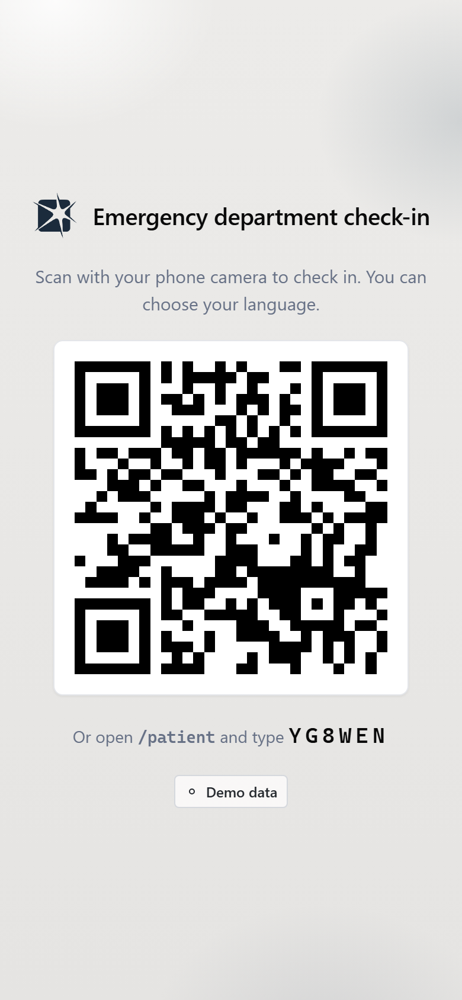<br><sub>Entrance QR</sub></td>
    <td align="center" width="25%">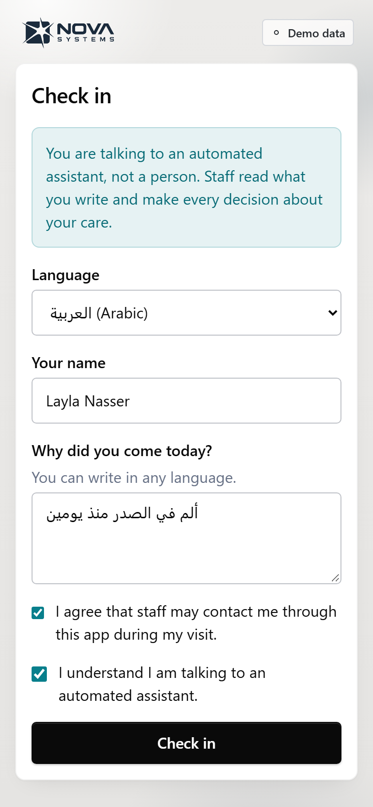<br><sub>Check-in, in Arabic</sub></td>
    <td align="center" width="25%">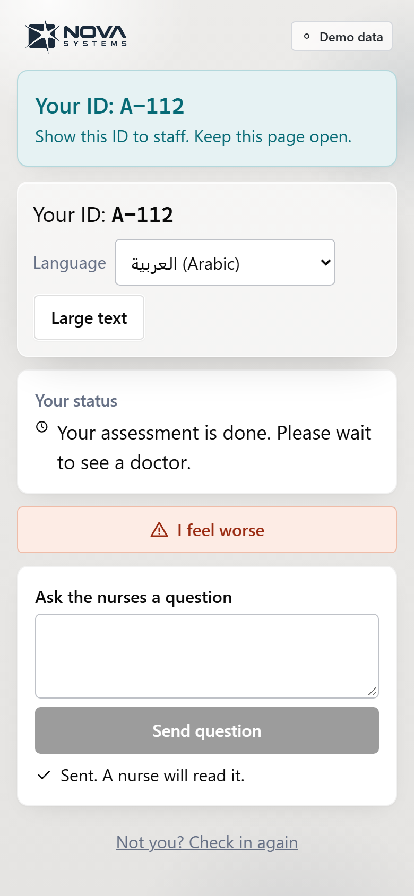<br><sub>Status and questions</sub></td>
    <td align="center" width="25%">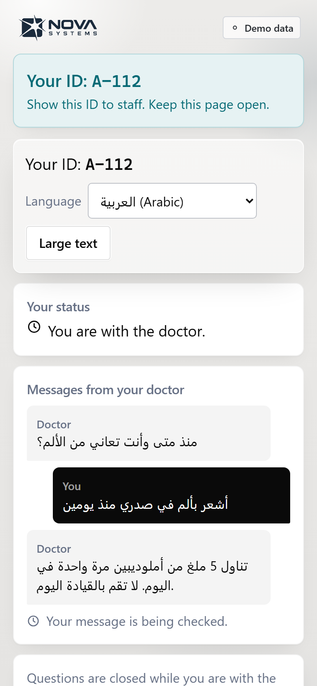<br><sub>Doctor's messages, in Arabic</sub></td>
  </tr>
</table>

**2. Triage.** The card appears on the nurse board. The nurse calls the patient for triage and sets the priority:
that decision is the nurse's, never the AI's. Questions from patients arrive in the inbox with an AI-suggested
tier, which the AI may raise but never lower. Clicking a card opens the visit overview.

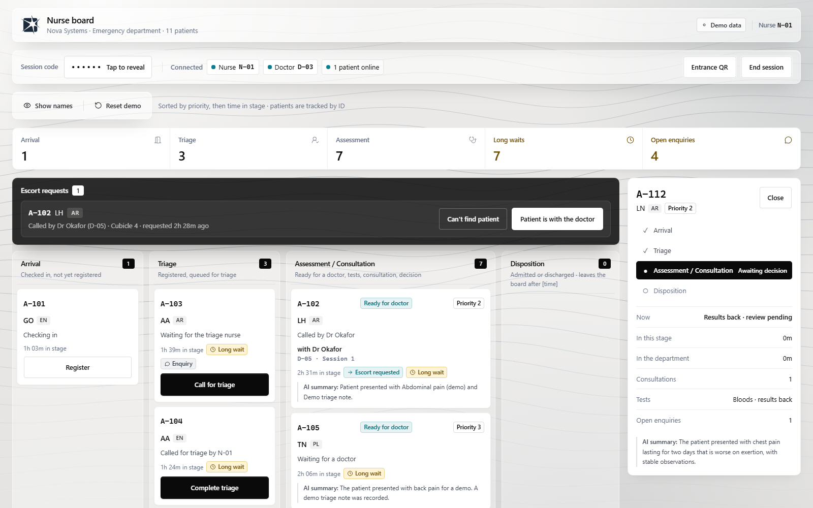

**3. Ready to be seen.** The doctor's queue is sorted by the nurse's priority, then by wait. The profile shows the
reason for the visit in the patient's words with a translation, the triage record, and an AI summary labelled as
such.

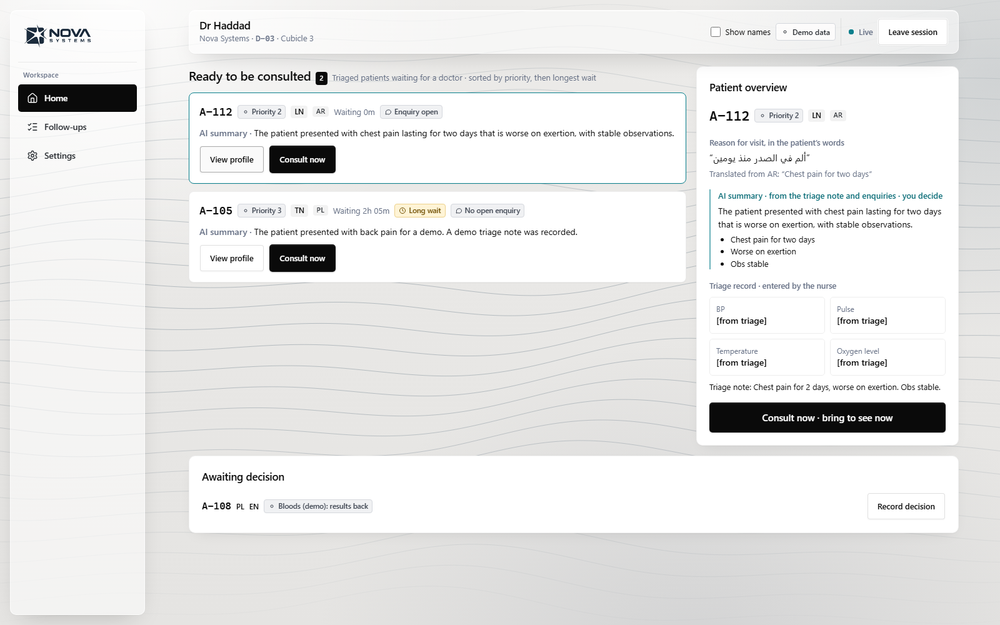

**4. Consultation.** The doctor types each line. It is translated into the patient's language and checked before
the doctor can send it; the card shows what the patient will read (a back-translation into English). Patient
replies are translated the other way and marked "AI-checked" or "Needs checking". A consent question is held and
routed to the hospital interpreter service. Meanwhile the AI drafts the Clinical Assessment from the conversation,
citing the lines it used; the doctor corrects it and signs.

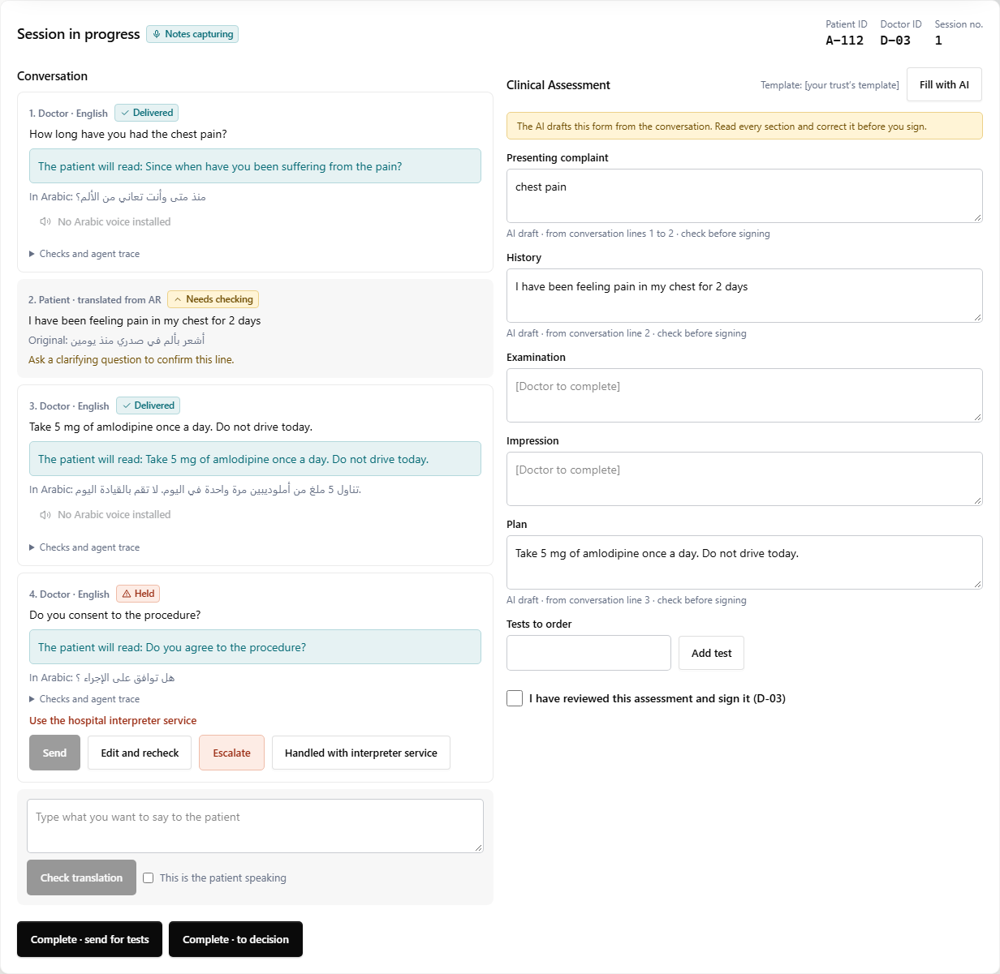

**5. Follow-ups and results.** Signing the assessment drafts follow-up tasks for the doctor to confirm, edit or
dismiss. When results are back the doctor records the outcome and releases a results pack, which the patient reads
in their language. Clinical wording the team has not written yet, such as "When to get help", stays a visible
`TODO(clinician)` placeholder instead of being invented.

<table>
  <tr>
    <td width="70%">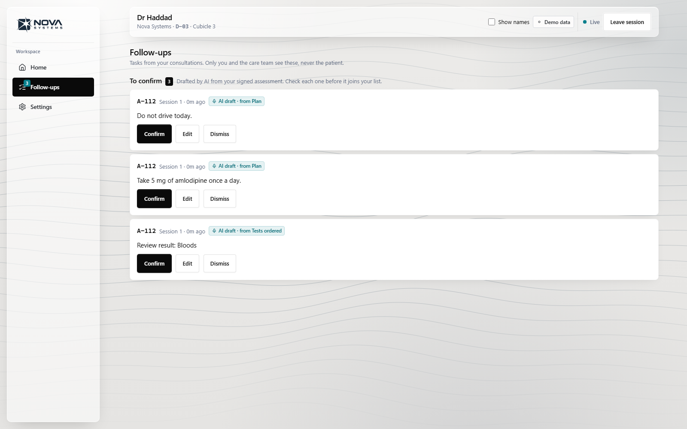</td>
    <td width="30%" align="center">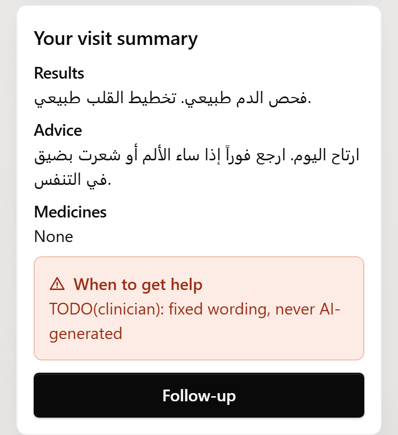</td>
  </tr>
</table>

## How it is connected

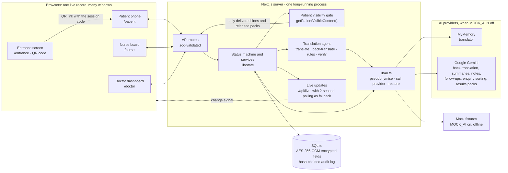

## How a consultation line is checked

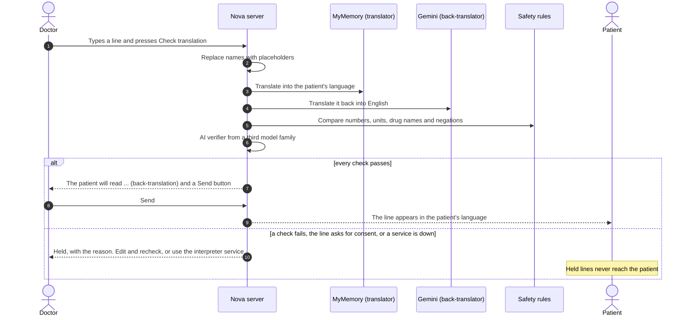

The patient's journey on the board:

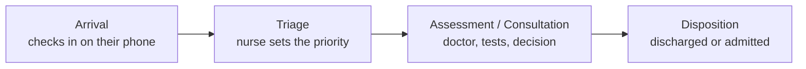

## AI agents and who decides

| Agent | What it does | Who decides | Provider |
| --- | --- | --- | --- |
| Intake translator | Translates the reason for the visit into English, keeping the original beside it | Nurse, at triage | Gemini |
| Enquiry triage | Fixed red-flag rules first, then an AI category and a suggested tier | Nurse confirms or overrides; AI can raise a tier, never lower it | Gemini |
| Patient summary | Short summary of the reason, triage note and questions | Doctor reads it; it summarises and never assesses | Gemini |
| Translation agent | Translation, back-translation, rule checks and an AI verifier, with retries and a trace | Doctor reads what the patient will read, then sends; held lines go to the interpreter service | MyMemory, Gemini, verifier (see below) |
| Clinical Assessment draft | Drafts the note template from the conversation, citing the lines used | Doctor corrects and signs; nothing is signed automatically | Gemini |
| Follow-ups | Drafts tasks from the signed note and the tests ordered | Doctor confirms, edits or dismisses | Gemini |
| Results pack | Rewords the doctor's results and advice in the patient's language; medicines unchanged | Doctor verifies and releases | Gemini |

Not AI, by design: triage priority, queue order, escort requests, timers, the status machine, IDs, and urgent or
red-flag wording, which is fixed text a clinician writes.

The translator, back-translator and AI verifier must be three different model families (the app refuses a config
where two match). The verifier currently runs as the labelled demo verifier, because the Gemma model chosen for it
was too slow on the free plan; set `translation.aiVerifier` in `data/config.json` to switch it back. Details and
setup are in [`AI_SETUP.md`](AI_SETUP.md).

## Safety and privacy

- **Synthetic data only.** No real patients, names or phone numbers. Every staff screen is labelled "Demo data".
- **One gate for patient-facing content.** `getPatientVisibleContent()` returns only delivered lines, pre-approved
  phrases and released results packs; never drafts, held or escalated lines. It has automated tests.
- **Humans decide.** AI never sets priority, urgency, diagnoses, doses, test orders or outcomes.
- **Identifiers removed before AI calls.** Names are replaced with placeholders before any provider sees the text,
  and restored afterwards.
- **Encrypted at rest.** Names, reasons, notes, messages and packs are stored with AES-256-GCM envelope encryption,
  with the key kept outside the database.
- **Tamper-evident audit log.** Every transition is recorded in a hash chain that stores hashes, never plaintext.
- **Honest limits.** This is not zero-knowledge. With MOCK_AI off, pseudonymised clinical text is sent to MyMemory
  and Google. Clinical content nobody has written yet is left as `TODO(clinician)` rather than invented.

## Tech stack

Next.js 16 (App Router) · React 19 · TypeScript 5 (strict) · Tailwind CSS 4 · SQLite via better-sqlite3 · zod 4 ·
Radix UI and lucide-react · Google Gemini API · MyMemory · Vitest · Playwright

## Run it locally

You need Node.js 22.

```bash
npm install
```

```bash
cp .env.example .env.local
```

Generate an encryption key and paste it into `.env.local` as `MASTER_KEY_BASE64`:

```bash
node -e "console.log(require('crypto').randomBytes(32).toString('base64'))"
```

```bash
npm run dev
```

Open http://localhost:3000 and use the cards to open the Patient, Nurse and Doctor windows. On `/demo` you can
reset and seed the board with synthetic patients and switch MOCK_AI on or off.

- **MOCK_AI on** (the default): every AI step is an offline, labelled fixture. Good for rehearsals.
- **MOCK_AI off:** add `GEMINI_API_KEY` to `.env.local`, restart, and switch it off on `/demo`.

A walk-through: on the nurse board press **Start session** (the entrance QR opens), then **Tap to reveal** for the
code. The doctor joins with that code. A patient opens the QR link and checks in. The nurse triages, the doctor
presses **Consult now**, the nurse confirms **Patient is with the doctor**, and the doctor starts the session.

## Share it with other devices

To let other people's phones scan the QR (for example judges at a demo), run a production build and share it
through a tunnel such as a Cloudflare quick tunnel:

```bash
npm run build
```

```bash
npm start -- -p 3102
```

```bash
cloudflared tunnel --url http://localhost:3102
```

Open the nurse board through the tunnel link, so the entrance QR points at that link. Quick tunnels hold back the
live event stream; the app notices and refreshes every 2 seconds instead.

Nova needs **one long-running server**: the database is a single SQLite file and live updates go through the
server's memory. Serverless hosting such as Vercel runs many short-lived copies, each with its own database, so
sessions split between them. A single-server host with a persistent disk works (`railway.json` is included for
Railway); Vercel would need a hosted database first.

## Tests

```bash
npm test
```

```bash
npx playwright install chromium
```

```bash
npm run test:e2e
```

Unit tests (Vitest, in-memory database) cover the status machine, safety rules, enquiry tiers, privacy helpers, the
patient visibility gate and the AI providers. The Playwright rehearsal runs a whole visit across patient, nurse and
doctor windows. `npm run typecheck` and `npm run privacy:selftest` are also available.

To refresh the README screenshots, start a production server on its own database and run the capture script:

```bash
npx tsx scripts/readme-screenshots.ts
```

## Project structure

```
app/                  pages (/, /patient, /nurse, /doctor, /entrance, /demo) and API routes
components/           patient, nurse and doctor screens, plus shared UI
lib/ai.ts             the only module that calls an AI provider (with lib/ai.prompts.ts and MOCK_AI fixtures)
lib/agents/           the translation agent: translate, back-translate, rule check, verify, trace
lib/state/            status machine, services, views, patient visibility gate, seed
lib/rules/            safety checks, enquiry tiers, priority rules (pure functions)
lib/privacy/          envelope encryption, pseudonymisation, hash-chained audit log
data/                 config.json (clinician-owned), demo defaults, pre-approved phrases
scripts/              seed, README screenshots, demo video
tests/, e2e/          Vitest and Playwright tests
docs/                 SPEC.md, ACCEPTANCE.md, CONTRACT.md and the design references
```

## Limitations

- A hackathon prototype with synthetic data. It has not been clinically validated and is not a medical device.
- Red-flag phrases, tier tables, urgent wording, the note template and the test list are `TODO(clinician)`
  placeholders, filled with labelled demo values where needed.
- Machine translation can be wrong. The checks reduce the risk; they do not remove it, which is why the doctor
  confirms every line and high-risk content goes to the interpreter service.
- On a free Gemini plan, short bursts of requests can hit the per-minute limit.

## Further reading

- [`docs/SPEC.md`](docs/SPEC.md): product spec
- [`docs/ACCEPTANCE.md`](docs/ACCEPTANCE.md): acceptance checklist
- [`docs/CONTRACT.md`](docs/CONTRACT.md): API contract
- [`AI_SETUP.md`](AI_SETUP.md): AI providers and setup
- [`CLAUDE.md`](CLAUDE.md): the project's hard rules
